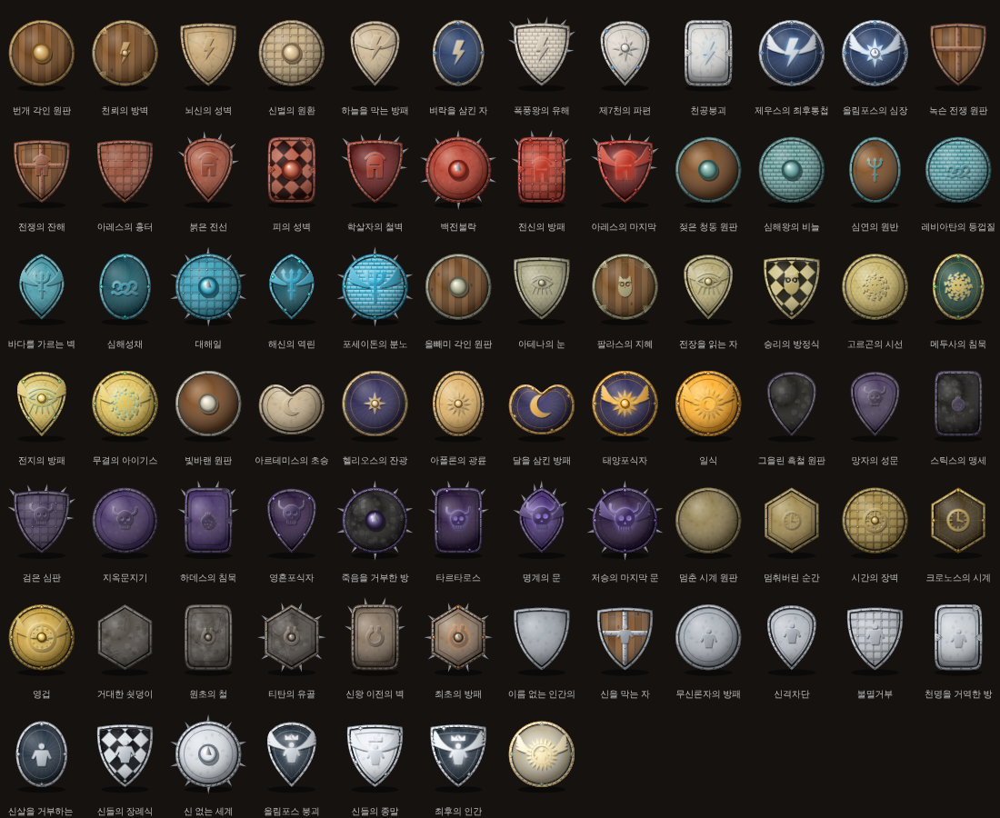

# 🛡 올림포스 대장간 · OLYMPUS FORGE

> 일어나라, 인간. 내 방패를 만들어라.

티탄과의 전쟁을 앞둔 신들을 위해, 붙잡혀 온 인간 대장장이가 방패를 깡깡 두드려 강화하는 3D 웹 게임입니다.

**▶ 플레이: https://i0kyung.github.io/olympus-daejanggan/**

- 둥근 다이얼의 바늘이 금색에 올 때 **깡!** — 랜덤 강화(대성공·성공·유지·하락·파괴)
- 신 9계열 · 방패 70종 + 숨겨진 「THE LAST AEGIS」 도감
- 강화할수록 형태·재질·장식이 바뀌는 3D 방패 (three.js)
- 직접 해보는 튜토리얼, 불꽃 질주, 장인의 집념, 보호석, 신들의 의뢰
- 음악·효과음은 모두 코드로 직접 생성

## 💬 새 소식 · 개선 제안
[𝕏 @i0kyung](https://x.com/i0kyung) 으로 DM 주세요.

## 🔨 응원하기
- 💛 [카카오페이로 바로 보내기](https://qr.kakaopay.com/FZ946M6xm)
- 카카오페이증권 020-07-776986
- 토스뱅크 100093026944

---
그리스 신화 모티브의 오리지널 게임 · 만든 사람 [@i0kyung](https://x.com/i0kyung)
